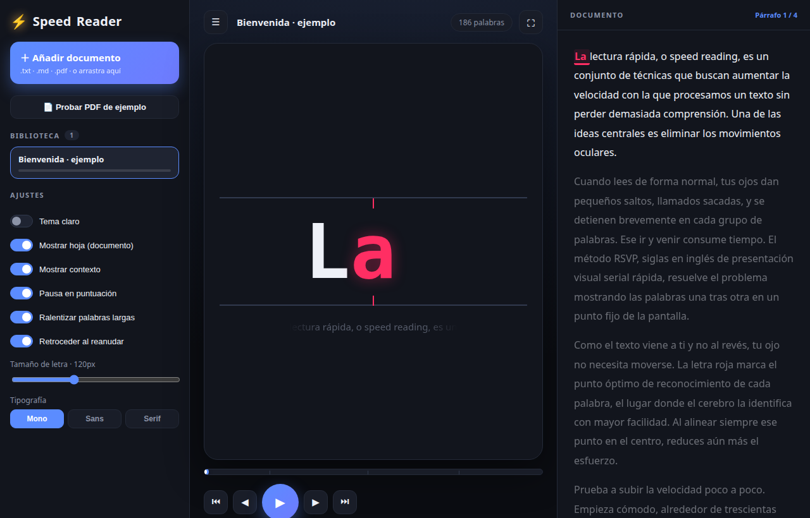

# ⚡ Speed Reader (RSVP)

Lector de **lectura rápida** (speed reading) por el método **RSVP** (*Rapid Serial
Visual Presentation*): muestra las palabras una tras otra en un punto fijo, con la
letra pivote resaltada en **rojo** sobre la línea central para que el ojo no tenga
que moverse.



## ✨ Características

- **Palabra centrada por el ORP** (*Optimal Recognition Point*): la letra roja se
  mantiene siempre clavada en la línea roja, sea cual sea la longitud de la palabra.
- **Carga de documentos**: `.txt`, `.md` (se limpian los símbolos de markdown) y
  **`.pdf`** (extracción de texto en el servidor).
- **Biblioteca** de documentos con progreso y posición guardada (localStorage).
- **Hoja / documento** a la derecha: resalta el párrafo actual y **subraya la
  palabra** mientras avanza, con auto-scroll.
- **Panel de contexto** opcional (palabras anteriores y siguientes atenuadas).
- **Estadísticas en vivo**: progreso, velocidad real, tiempo leído y restante.
- **Ajustes**: velocidad (100–1200 ppm), palabras por golpe, tamaño de letra,
  tipografía (mono/sans/serif), pausas en puntuación, ralentizar palabras largas.
- **Tema claro/oscuro**, **modo enfoque**, **drag & drop** y atajos de teclado.

## 🧱 Stack

- **Frontend**: React 18 + Vite
- **Backend**: Node.js + Express
- **PDF**: `pdf-parse` · **Markdown**: parser propio con regex (sin dependencias)
- CSS puro con variables (sin framework de UI ni librería de estado)

## 🚀 Uso

```bash
npm install
npm run dev     # cliente en http://localhost:5173 · API en http://localhost:8099
```

Producción:

```bash
npm run build   # genera client/dist
npm start       # Express sirve el build + la API
```

## ⌨️ Atajos

| Tecla | Acción |
|---|---|
| `espacio` | Play / Pausa |
| `←` `→` | Palabra anterior / siguiente |
| `↑` `↓` | Subir / bajar velocidad |
| `F` | Modo enfoque |
| `R` | Reiniciar |

## 📁 Estructura

```
server/            API Express (parseo de md y pdf)
client/            App React + Vite
  src/reader.js    Tokenización y cálculo del ORP
  src/Reticle.jsx  Zona de lectura (palabra + línea roja)
  src/Sheet.jsx    Hoja/documento con subrayado
scripts/           Generador del PDF de ejemplo
```

## 📄 Licencia

MIT
